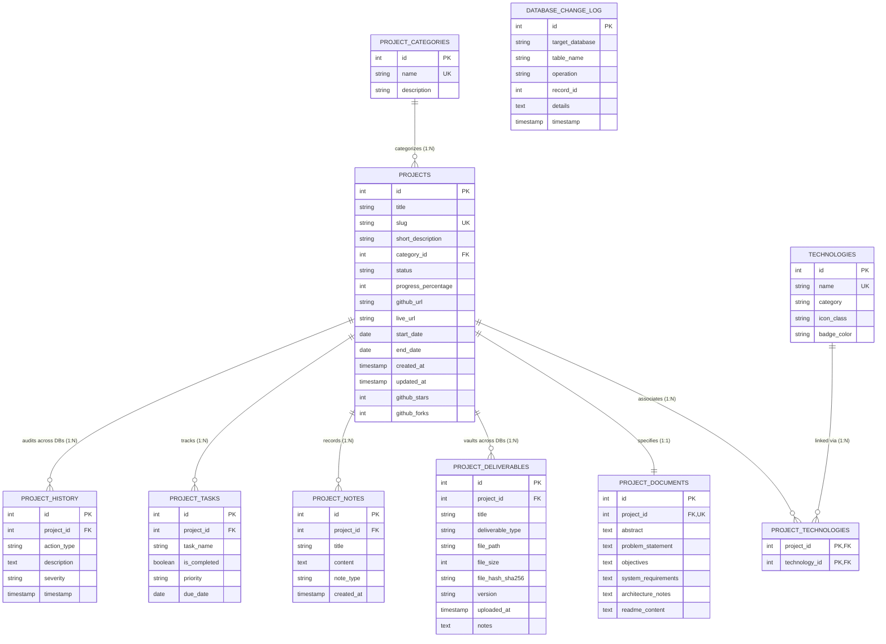
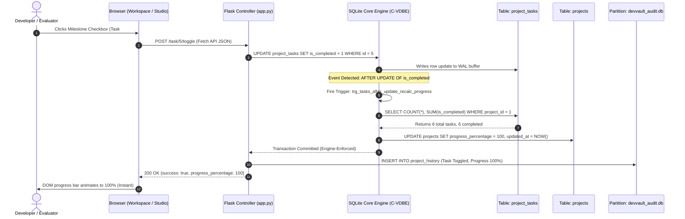
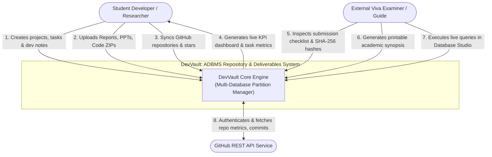
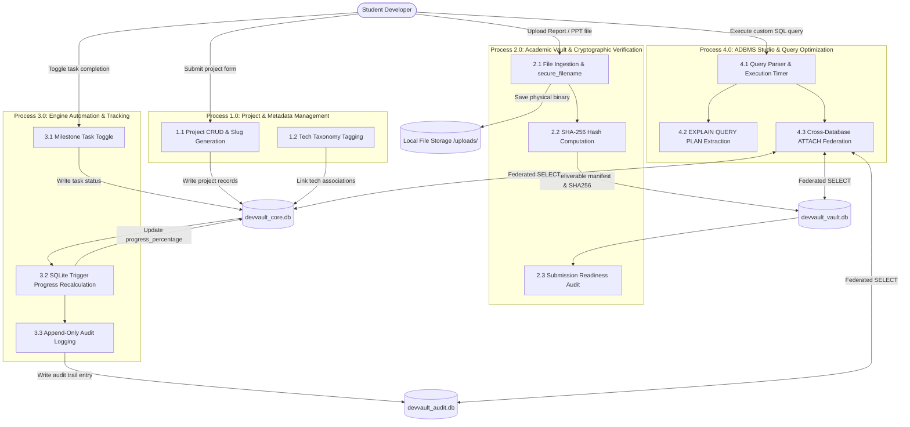
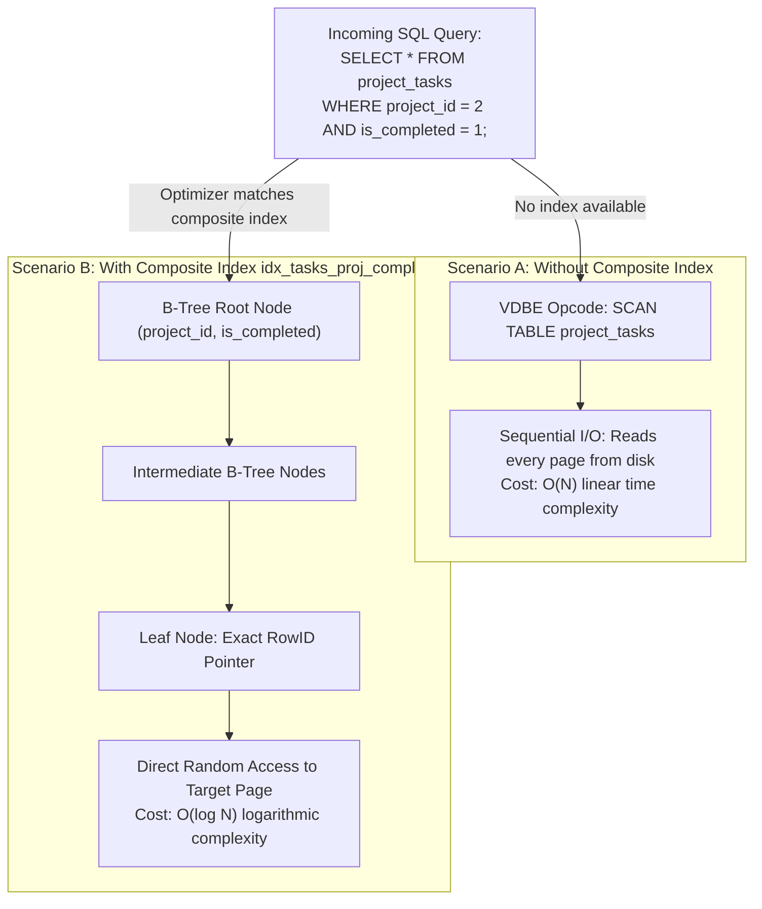
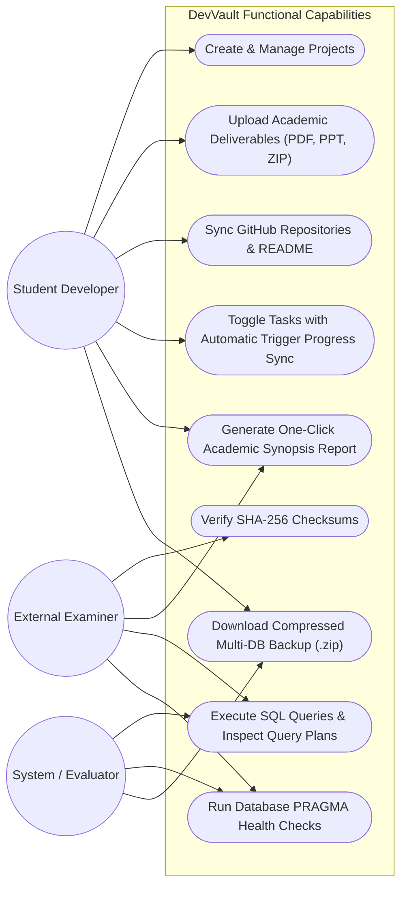

# DEVVAULT: ADVANCED DATABASE SYSTEM ARCHITECTURE & DESIGN DIAGRAMS (MERMAID.JS)
## Comprehensive Diagram Suite for ADBMS Evaluation, Report, and Defense

This document provides clean, renderable **Mermaid.js** code blocks representing the **DevVault** partitioned database architecture, relational schema, procedural triggers, data flow, and optimization pipelines.

---

## 1. TRI-PARTITIONED MULTI-DATABASE TOPOLOGY
*Illustrates the physical separation of concerns across the three partitioned SQLite files, SQLAlchemy binds, and the federated cross-database connection.*

```mermaid
flowchart TD
    subgraph ClientLayer ["Client / Browser Presentation Layer"]
        UI["Web Browser (Bootstrap 5, Chart.js, Vanilla ES6+)"]
    end

    subgraph AppLayer ["Flask 3.x Application Tier"]
        CTRL["Flask Controllers & Routing (app.py)"]
        ORM["SQLAlchemy Multi-Bind Engine"]
        MGR["ADBMS Manager (adbms_service.py)"]
        FED["Federation Engine (ATTACH DATABASE)"]
    end

    subgraph PartitionLayer ["ADBMS Physical Database Storage Tier"]
        subgraph CoreDB ["Partition 1: devvault_core.db"]
            direction TB
            T_PROJ["projects (Metadata & Progress)"]
            T_CAT["project_categories"]
            T_TECH["technologies & project_technologies"]
            T_DOC["project_documents (Abstract, Specs)"]
            T_TASK["project_tasks (Milestones)"]
            T_NOTE["project_notes (Dev Journals)"]
            T_SET["system_settings"]
            TRG_TASK["⚡ Triggers: trg_tasks_recalc_progress"]
            VW_TASK["📊 View: vw_project_task_summary"]
            VW_TECH["📊 View: vw_tech_distribution"]
        end

        subgraph VaultDB ["Partition 2: devvault_vault.db"]
            direction TB
            T_DELIV["project_deliverables"]
            F_SHA["SHA-256 Cryptographic Hashes"]
            F_PATH["Local Filesystem Pointers (/uploads/)"]
            VW_VAULT["📊 View: vw_vault_storage_analytics"]
        end

        subgraph AuditDB ["Partition 3: devvault_audit.db"]
            direction TB
            T_HIST["project_history (Append-Only)"]
            T_CDC["database_change_log (DDL/DML CDC)"]
            IDX_TIME["⚡ B-Tree Index: idx_history_proj_timestamp"]
        end
    end

    UI <-->|HTTP / JSON / AJAX| CTRL
    CTRL --> ORM
    CTRL --> MGR
    MGR --> FED
    ORM -->|Default Bind| CoreDB
    ORM -->|Bind: 'vault'| VaultDB
    ORM -->|Bind: 'audit'| AuditDB
    FED -.->|ATTACH 'devvault_vault.db' AS vault_db| VaultDB
    FED -.->|ATTACH 'devvault_audit.db' AS audit_db| AuditDB
```

---

## 2. ENTITY-RELATIONSHIP (ER) DIAGRAM
*Relational schema representing all 11 tables across the partitioned databases, indicating primary keys, foreign keys, SHA-256 hashes, and cardinalities.*

---

## 3. PROCEDURAL SQLITE TRIGGER EXECUTION SEQUENCE
*Illustrates how native engine triggers execute directly within the SQLite Virtual Database Engine (VDBE) upon task completion.*

---

## 4. DATA FLOW DIAGRAM (DFD LEVEL 0 - CONTEXT DIAGRAM)
*High-level context diagram showing external entities and interactions with DevVault.*

---

## 5. DATA FLOW DIAGRAM (DFD LEVEL 1 - DETAILED PROCESS DECOMPOSITION)
*Detailed subsystem decomposition of DevVault data flows.*

---

## 6. QUERY OPTIMIZATION: B-TREE INDEX vs. FULL TABLE SCAN
*Illustrates the Virtual Database Engine (VDBE) search path through the composite index.*

---

## 7. UML USE CASE DIAGRAM
*Actor use cases across project tracking, academic file management, and database studio exploration.*

